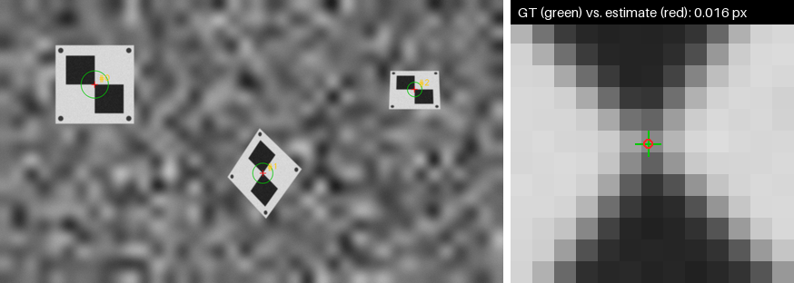
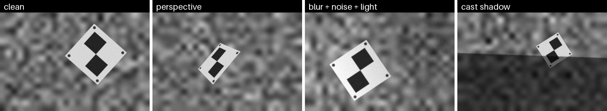
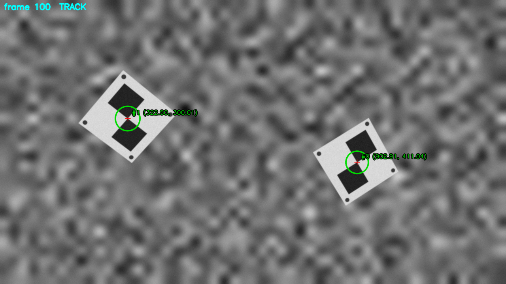

# Robust Sub-pixel Detection of Geospatial Ground Control Points

[](https://github.com/Mnankam/subpixel-gcp-detector/actions/workflows/ci.yml)


Detection and **sub-pixel centre estimation of 2×2 checkerboard targets** (ground control
points, GCPs) in aerial / UAV imagery – written in modern C++ with OpenCV and Eigen, without
`cv::findChessboardCorners`.



*Left: three GCPs with perspective distortion, screws and textured background. Right: 13×13 px
around one centre – ground truth (green) vs. estimate (red), error 0.016 px.*

## Why

In photogrammetric 3D reconstruction the georeferencing accuracy is bounded by how precisely the
ground targets are measured in the images. Generic corner detectors (Harris, Shi-Tomasi) and even
`cv::cornerSubPix` struggle with what real field targets look like: strong perspective, low
resolution, cast shadows, mounting screws, material texture and uneven illumination.

## Method

```
image ──► Phase A: RoI detection ─────────────────────────────► Phase B: sub-pixel saddle point
          CLAHE                                                 Förstner orthogonality model
          adaptive (2 scales) + Otsu threshold, both polarities  + Huber IRLS (robust scale)
          erosion (splits quadrants touching at the centre)      + symmetric Lanczos resampling
          closed contours → convex quads (blob-shaped rejected)  + 2×2 SVD solve (Eigen)
          quad vertices = centre candidates
          ring test: 4 alternating sectors, centrally symmetric ──► strict ring test at refined centre
```

### Phase A – candidates and topological validation

* **CLAHE** compensates illumination gradients across the target.
* Closed contours from several binarizations are approximated by polygons; only **convex
  quadrilaterals** survive. A quad whose area differs from its contour area by > 15 % is the
  inscribed square of a round blob (screw heads, bolts) and is discarded.
* Every quad vertex is a centre candidate. A candidate is accepted only if a circle around it
  shows **exactly four alternating sectors** (dark–light–dark–light) that are **centrally
  symmetric**. The threshold along the ring is the mean of the surrounding half circle, so it adapts
  to cast shadows that darken one side of the target.

### Phase B – robust Förstner saddle point

At a checkerboard centre $c$ all edges pass through $c$, so for every pixel $p$ the gradient
$\nabla I(p)$ is orthogonal to $p-c$. With $n = \nabla I / \lVert\nabla I\rVert$:

$$
E(c) = \sum_p w_s(p)\,\lVert\nabla I(p)\rVert^2\,\rho_{\text{Huber}}\!\left(n(p)^\top (p-c)\right)
$$

$w_s$ is a Gaussian window. $E$ is minimized by **iteratively reweighted least squares**; each
iteration solves a 2×2 system via SVD, whose singular value ratio doubles as a saddle-vs-edge test.
Because straight lines stay straight under a homography, the model is exact for perspectively
distorted targets.

Three details make the difference to `cv::cornerSubPix`, which implements the plain version of the
same model:

1. **Symmetric resampling (no pixel locking).** In every iteration the patch is resampled so that
   the window is centred *exactly* on the current estimate. A blurred saddle is locally
   point-symmetric, so all asymmetric contributions cancel at the fixed point. Integer-grid windows
   bias the result towards pixel centres.
2. **Exact interpolation.** `cv::remap` / `cv::getRectSubPix` quantise the sub-pixel phase to
   1/32 px, which caps the achievable accuracy and makes the iteration oscillate. The refiner uses
   its own separable Lanczos-3 resampler in double precision.
3. **Huber M-estimator with adaptive scale.** The threshold is $1.345\cdot\hat\sigma$ with
   $\hat\sigma = 1.4826\cdot$ weighted median of the residuals – the residual scale grows with blur,
   so a fixed pixel threshold would either be useless or bias the estimate.

## Results

Monte-Carlo evaluation on synthetic images with analytic ground truth (`gcp_eval`, 100 trials per
scenario, random position, rotation and target size 60–160 px). Refiners start from a ±2 px
perturbed guess with identical window size. Errors in pixels.

| Scenario | Method | RMSE | Median | P95 | Missed |
|---|---|---:|---:|---:|---:|
| clean | **Detector (full pipeline)** | **0.018** | 0.015 | 0.030 | 0/100 |
| clean | `cv::cornerSubPix` | 0.030 | 0.023 | 0.059 | – |
| perspective (tilt ≤ 50°) | **Detector (full pipeline)** | **0.018** | 0.013 | 0.034 | 2/100 |
| perspective (tilt ≤ 50°) | Refiner, plain least squares | 0.028 | 0.012 | 0.031 | – |
| perspective (tilt ≤ 50°) | `cv::cornerSubPix` | 0.196 | 0.024 | 0.046 | – |
| blur + noise + light | **Detector (full pipeline)** | **0.082** | 0.062 | 0.140 | 1/100 |
| blur + noise + light | `cv::cornerSubPix` | 0.090 | 0.069 | 0.158 | – |
| cast shadow | **Detector (full pipeline)** | **0.026** | 0.016 | 0.049 | 4/100 |
| cast shadow | Refiner, plain least squares | 0.217 | 0.018 | 0.585 | – |
| cast shadow | `cv::cornerSubPix` | 0.497 | 0.031 | 1.180 | – |

Takeaways:

* Without disturbances the refiner is **~1.7× more accurate** than `cv::cornerSubPix`; in a
  noise-free bias test it is several times better (see `LowerSystematicErrorThanCornerSubPix`).
* With a shadow edge crossing the window, plain least squares (and `cornerSubPix`) break down
  (P95 0.6–1.2 px); the **Huber term keeps the error at 0.05 px**.
* Under heavy blur and noise all methods are noise-limited; the robust estimator is still best.
* 1 false positive in 400 images. A 640×480 image takes ~17 ms single-threaded.

The full table (including timings and the ablation) is regenerated by CI on every push and shown
in the job summary.



### A note on the ground truth

The synthetic renderer had to be physically correct before the numbers meant anything. The
optical blur (PSF) is applied on a 4× oversampled grid **before** pixel integration, and edge
pixels are integrated with 128×128 samples. Blurring an already pixel-integrated image bakes
aliasing into the "ground truth" and makes *every* estimator look biased by ~0.05 px.

## Build

Requirements: CMake ≥ 3.22, a C++20 compiler, OpenCV 4 (core, imgproc, imgcodecs), Eigen 3.3+,
GoogleTest (found on the system or fetched automatically).

```bash
sudo apt install cmake ninja-build libopencv-dev libeigen3-dev libgtest-dev   # Ubuntu 24.04
cmake -S . -B build -G Ninja -DCMAKE_BUILD_TYPE=Release
cmake --build build
ctest --test-dir build --output-on-failure
```

Options: `-DGCP_ENABLE_SANITIZERS=ON` (ASan + UBSan), `-DGCP_WARNINGS_AS_ERRORS=ON`.

## Usage

```bash
./build/gcp_detect --draw annotated.png image.jpg     # CSV on stdout
./build/gcp_detect --json *.jpg                        # JSON
./build/gcp_eval --trials 200                          # accuracy benchmark (Markdown)
```

```
file,id,x,y,scale,contrast,residual_rms,isotropy,time_ms
docs/demo_scene.png,0,180.2806,160.7033,52.0,167.5,0.5420,0.991,41.04
```

### Docker

```bash
docker build -t gcp-detector .
docker run --rm -v "$PWD:/data" gcp-detector --json image.jpg
# or the image built by CI:
docker run --rm -v "$PWD:/data" ghcr.io/Mnankam/subpixel-gcp-detector:main --json image.jpg
```

The multi-stage build compiles **and runs the test suite**; the runtime image only contains the
binaries and the three OpenCV runtime libraries.

### Library

```cpp
#include <gcp/target_detector.hpp>

gcp::TargetDetector detector;                       // all parameters in gcp::DetectorParams
for (const auto& d : detector.detect(image))
  std::cout << d.center << '\n';                    // cv::Point2d, OpenCV pixel convention

gcp::SaddleRefiner refiner({.half_window = 9});     // refine your own initial guesses
auto r = refiner.refine(gray, {412.0, 233.0});
```

## Live camera mode (Basler pylon / GenICam)



`gcp_live` runs the detector on an image stream: a **Basler camera via the pylon SDK**, the
**pylon camera emulator** (no hardware needed), a list of image files, or a synthetic moving
scene with ground truth.

```
FrameSource (interface)
 ├── SyntheticSource   moving targets + exact ground truth (CI)
 ├── ImageFileSource   recorded image sequences
 └── PylonSource       Basler cameras / emulator via GenICam (optional, GCP_WITH_PYLON)
          │
       Tracker ── constant-velocity prediction ─► SaddleRefiner + ring test   (≈ 1 ms)
          └────── every N frames / on loss ─────► full TargetDetector        (≈ 40 ms)
```

The full detector (CLAHE, thresholds, contours) is expensive; refining a *known* target is not.
The tracker therefore only refines each target at its predicted position and falls back to full
detection every N frames or when a target is lost.

Synthetic 1280×720 stream, 2 moving and tilting targets, 300 frames:

| Metric | Value |
|---|---:|
| Tracking update, median | **0.95 ms** |
| Full detection, median | 42 ms |
| Full detections needed | 10 of 300 frames |
| Ground-truth RMSE | **0.017 px** (600 measurements, 0 missed) |

### Camera parameters through GenICam

`PylonSource` opens the first camera (or a given serial number), sets `PixelFormat=Mono8`,
switches off `ExposureAuto`/`GainAuto` when values are given, and sets `ExposureTime`
(falls back to the SFNC 1.x name `ExposureTimeAbs`) and `Gain`. It grabs with
`GrabStrategy_LatestImageOnly` – live processing should always work on the newest frame instead
of building up latency in a queue. Incomplete buffers (e.g. GigE packet loss) are skipped, not
fatal. Non-Mono8 formats (Bayer, Mono12) go through `CImageFormatConverter`.

### Build with pylon

1. Install the free [pylon Software Suite](https://www.baslerweb.com/en/downloads/software/)
   including the SDK and the camera emulation support.
2. Configure with pylon (and optionally the preview window):

```bash
cmake -S . -B build -DGCP_WITH_PYLON=ON -DGCP_WITH_GUI=ON
# Windows, if pylon is not found automatically:
#   -DCMAKE_PREFIX_PATH="C:/Program Files/Basler/pylon/Development/CMake"
cmake --build build
```

3. Run against the emulator – no camera required:

```bash
export PYLON_CAMEMU=1                       # Windows PowerShell: $env:PYLON_CAMEMU=1
./build/gcp_live --source pylon --emulator --emu-images docs/demo_scene.png --show
```

4. Real camera:

```bash
./build/gcp_live --source pylon --exposure-us 2000 --gain-db 0 --show
./build/gcp_live --source pylon --serial 40012345 --frames 0 > tracks.csv
```

Other sources: `gcp_live --source synthetic --frames 300`, `gcp_live --source files img_*.png`.
Without `-DGCP_WITH_PYLON=ON` everything else builds and runs; `--source pylon` then reports that
support is missing. CI builds without pylon (the SDK is not redistributable) and runs the
synthetic live benchmark on every push.

## CI/CD

| Job | What it does |
|---|---|
| `clang-format` | style check |
| `gcc-release`, `clang-release` | build with `-Werror`, run unit tests |
| `gcc-debug-asan-ubsan` | tests under AddressSanitizer + UndefinedBehaviorSanitizer |
| `accuracy benchmark` | runs `gcp_eval` and the synthetic `gcp_live` stream, posts both tables to the job summary |
| `docker image` | builds the image; pushes to GHCR on `main` and on tags |
| `github release` | on `v*` tags: binaries + benchmark attached to a release |

Dependabot keeps the GitHub Actions and the Docker base image up to date.

## Project layout

```
include/gcp/        public headers (detector, refiner, synthetic renderer)
src/                implementation
apps/               gcp_detect (CLI), gcp_eval (benchmark), gcp_live (camera / stream)
src/io/             image file source, Basler pylon source
tests/              GoogleTest suite (accuracy, robustness, false positives)
docs/               figures
.github/workflows/  CI/CD
```

## Limitations and next steps

* Very strong perspective (both tilts close to 50°) occasionally fails the quad test.
* Validation on **real UAV images** with surveyed GCPs is the next step; the synthetic benchmark
  only covers the artefacts that are modelled.
* Large images: tiling + parallel candidate refinement (`std::execution` / TBB).
* Target identification (coded targets / ArUco ID next to the checkerboard).
* Hardware trigger and multi-camera synchronisation (`CInstantCameraArray`, PTP on GigE).

## References

1. W. Förstner, E. Gülch: *A fast operator for detection and precise location of distinct points,
   corners and centres of circular features.* ISPRS Intercommission Conf. on Fast Processing of
   Photogrammetric Data, Interlaken, 1987.
2. P. J. Huber: *Robust estimation of a location parameter.* Annals of Mathematical Statistics
   35(1), 1964.
3. C. Harris, M. Stephens: *A combined corner and edge detector.* Alvey Vision Conference, 1988.
4. L. Lucchese, S. K. Mitra: *Using saddle points for subpixel feature detection in camera
   calibration targets.* IEEE APCCAS, 2002. doi:10.1109/APCCAS.2002.1115151
5. D. Chen, G. Zhang: *A new sub-pixel detector for X-corners in camera calibration targets.*
   WSCG, 2005.
6. S. Placht et al.: *ROCHADE: Robust Checkerboard Advanced Detection for Camera Calibration.*
   ECCV, 2014.
7. A. Duda, U. Frese: *Accurate detection and localization of checkerboard corners for
   calibration.* BMVC, 2018. (basis of `cv::findChessboardCornersSB`)
8. A. Geiger, F. Moosmann, Ö. Car, B. Schuster: *Automatic camera and range sensor calibration
   using a single shot.* ICRA, 2012.
9. M. Rufli, D. Scaramuzza, R. Siegwart: *Automatic detection of checkerboards on blurred and
   distorted images.* IROS, 2008.
10. Z. Zhang: *A flexible new technique for camera calibration.* IEEE TPAMI 22(11), 2000.
11. K. Zuiderveld: *Contrast limited adaptive histogram equalization.* Graphics Gems IV, 1994.
12. S. Suzuki, K. Abe: *Topological structural analysis of digitized binary images by border
    following.* CVGIP 30(1), 1985. (`cv::findContours`)
13. R. Hartley, A. Zisserman: *Multiple View Geometry in Computer Vision.* 2nd ed., Cambridge
    University Press, 2004.
14. W. Förstner, B. P. Wrobel: *Photogrammetric Computer Vision.* Springer, 2016.
15. T. Luhmann, S. Robson, S. Kyle, J. Boehm: *Close-Range Photogrammetry and 3D Imaging.*
    De Gruyter.

## License

MIT – see [LICENSE](LICENSE).
